  
  
  

    
    
    
  

  <h3>Engineering secure, scalable, and reliable cloud solutions.</h3>

---

### 👨‍💻 About Me

I'm a **Communications and Electronics Engineering** student at **Mansoura University**, passionate about designing and securing modern cloud infrastructure.  
My interests revolve around **Cloud Architecture, AWS, Cloud Security, Infrastructure as Code, and Network Engineering**. I enjoy turning technical concepts into practical projects, building secure environments, and exploring how cloud technologies solve real-world problems.

- ☁️ Exploring multi-cloud environments and cloud-native architectures.
- 🔐 Interested in IAM, Zero Trust, network security, and cloud governance.
- 🏗️ Building infrastructure using Terraform and automation tools.
- 🎯 Working toward becoming a **Cloud Solutions Architect & Cloud Security Engineer**.

---

### 🛠️ Technologies & Tools

   
  <h4>☁️ Cloud Platforms</h4>
  

   
  <h4>⚙️ Infrastructure & Automation</h4>
  

   
  <h4>💻 Programming & Development</h4>
  

   
  <h4>🌐 Networking & Security</h4>
  

---

### 🚀 Projects & Practical Work

- **🎓 Zero-Trust Smart Campus**  
  *A hybrid-cloud graduation project combining cloud infrastructure, on-premises systems, and security-focused architecture.*  
  **Focus:** Hybrid Cloud · Zero Trust · Infrastructure · Automation · Security Monitoring

- **🏦 Secure Smart Banking Platform**  
  *A cloud architecture project focused on designing a secure and scalable banking environment.*  
  **Focus:** AWS · VPC · IAM · Network Segmentation · Terraform · Cloud Security

- **☁️ Highly Available AWS Web Architecture**  
  *A practical AWS architecture exploring scalability, availability, and load distribution.*

---

### 🎓 Education & Training

- **B.Sc. Communications & Electronics Engineering** — Mansoura University.
- **NTI** — Cloud Architect Summer Training Program: *120 training hours, final score 100%*.
- **Digital Egypt Pioneers Initiative (DEPI)**: *AWS Security & Cloud Computing Track*.
- **AWS Academy**: *Cloud Foundations & Cloud Architecting learning programs*.

---

### 📚 Current Learning Journey

- ☁️ Candidate for **AWS Certified Solutions Architect – Associate (SAA-C03)**.
- 🔐 **AWS Cloud Security** and IAM best practices.
- 🌐 **CCNA** and Network Engineering.
- 🏗️ **Terraform, Ansible**, and Infrastructure Automation.
- 🐧 **Linux, Python**, and Bash scripting.

---

### 📊 GitHub Analytics

  
  
   
  

---

  <h3>💡 <em>"Building secure infrastructure. Designing the cloud. Engineering what's next."</em></h3>
  
Thanks for visiting my profile!

